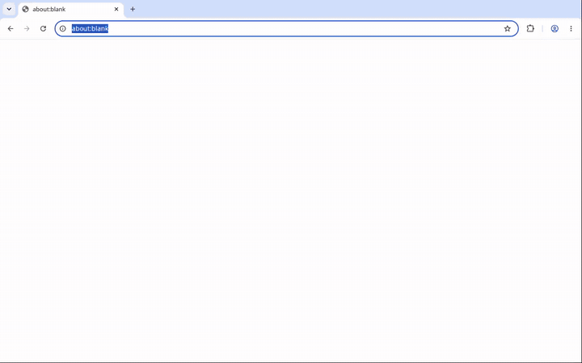

# LucidScan


*Demo recorded from the `feat/browse-badges-loadable` branch (PR #1), whose extension code is not on `main` yet. Setup, tech, and CI notes for `main` are in [docs/setup.md](docs/setup.md).*

Local browse-time **signal** badges for Chrome (MV3, load unpacked, v0.4.0), plus an optional Flask desktop path from TIDALHack 25.

Badges are a **local signal only** from on-device models — not an authenticity verdict.

## Quick start (Load unpacked + Enable)

1. `chrome://extensions` → **Developer mode** on → **Load unpacked** → pick `chrome_plugin/`.
2. Serve the sample page over http (Enable does not work on `file://`):
   ```bash
   cd chrome_plugin && ./test/serve.sh      # http://127.0.0.1:8765/test/sample.html
   ```
3. Open the sample page → LucidScan icon → **Enable badges on this site** → **Allow** (or `Alt+Shift+L`).
4. Visible images get a corner pill (`…` → `local score N`); select ≥12 chars of text for a floating chip.
5. First run downloads models from Hugging Face (progress shown in the popup under **Models**; **Retry model load** if it fails).
6. **Pause badges on this site** hides badges but keeps the enable; **Resume** brings them back; **Disable** removes the site enable and tears badges down. **Clear all enabled sites** resets everything.

Nothing is injected on any site until you enable it (no static `content_scripts`).

## Features (how to verify: `docs/feature-map.md`)

- **Inject-only per site:** optional host permission requested in the popup click (gesture-safe), then `scripting.registerContentScripts` for that origin only.
- **Image badges:** visible images only (IntersectionObserver), closed Shadow DOM pills, src-hash score cache (~200 entries, 24h TTL, memory LRU + IndexedDB).
- **Cheap prefilters:** tiny images, tiny data URIs, and near-flat images skip CLIP and show `unavailable` (reason in the tooltip).
- **Selection chip:** follows the selection on scroll/resize/visualViewport changes; flips below if clipped; readable on light and dark pages.
- **Models:** auto-warmup when the offscreen document starts; popup shows stage / % with Retry; **Cancel load watch** stops the progress UI (an in-flight download may still finish).
- **SPA support:** history-hook rebinding only (no `webNavigation`).
- **Zero `web_accessible_resources`**; no `addHostAccessRequest`.
- **No fallback numbers:** if a model fails to load or an image can't be read (e.g. cross-origin without CORS), badges show `unavailable`, never a made-up score.

## Tests

```bash
npm test                 # = bash scripts/test.sh: syntax check + health_check.py + node:test unit tests (offline, no browser)
npm run lint             # ESLint flat config on extension source (not the vendored lib/ bundle)
npm run typecheck        # tsc checkJs + JSDoc on the same sources (transformers.min.js excluded)
npm run test:e2e         # Playwright: headless Chromium loads unpacked chrome_plugin/, local fixture, Enable → badges, Disable tears down
python3 chrome_plugin/scripts/cdp_smoke.py   # optional: headless Chrome, Extensions.loadUnpacked, SW alive, 0 badges before Enable
node --experimental-websocket chrome_plugin/scripts/lifecycle_e2e.mjs /tmp/lucid-e2e   # optional, needs network: enable/disable/re-enable, first-run model load, cross-origin -> unavailable
```

`test:e2e` serves its own page on `127.0.0.1` (no external images). Model hosts are blocked by default so badges settle on `unavailable` instead of downloading about 435 MB; `LUCIDSCAN_E2E_ALLOW_MODELS=1` allows the Hugging Face fetch and still accepts either `local score N` or `unavailable` (`MODEL_WAIT_MS` raises the wait). The browser loads a temp copy of `chrome_plugin/` with `host_permissions` for that loopback origin only — the native permission bubble is not a page surface, and without a host grant Chrome hides `tab.url` from the popup. The manifest in git is unchanged.

`health_check.py` checks manifest validity, zero WAR, no static `content_scripts`, no `webNavigation` / `addHostAccessRequest`, no vendored weights, and scans UI strings + README for claim words. Unit tests cover the URL restriction guard, origin patterns, hashing, prefilters, and cache LRU/TTL. The CDP smoke needs `websocket-client` and network for the sample images.

## Known limits

- Cross-origin iframes are not scanned unless that origin is enabled separately; same-origin iframes may be.
- Restricted pages (`chrome://`, `file://`, Web Store, `view-source:`, other extensions) cannot be enabled.
- Cross-origin images that taint the canvas skip the flat-image prefilter and are sent by URL instead of a canvas copy.
- First run downloads about **435 MB** from Hugging Face (≈129 MB text + ≈306 MB CLIP fp16; measured, see below); later loads use the browser cache.
- Granting host permission needs a real click on the native bubble. `npm run test:e2e` pre-grants only the loopback fixture origin on a temp copy so the real popup Enable/Disable path can run headless. The manifest in git still has no install-time host permissions. `cdp_smoke.py` still stops at 0 badges before Enable.
- Scores are an uncalibrated local signal, not a verdict.

### What badges mean

| Label | Meaning |
|-------|---------|
| `…` | Score in flight |
| `downloading model N%` / `loading model…` | First-run model download/load; the badge retries with backoff (up to 10 min) |
| `local score N` | Local model **signal** (0–100 display). Not authenticity. |
| `unavailable` | No score: model failed/disabled, image unreadable, or prefilter skip (reason in tooltip) |

Transformers.js pipelines run in an **offscreen document** (`unavailable` if models are unavailable). Architecture matches `docs/lucidscan-mv3-local.md`:

- Content script = thin bridge (injected **only after** Enable badges on this site); **closed Shadow DOM** badges
- `MutationObserver` + `IntersectionObserver` (visible images only)
- `selectionchange` + Range floating chip for text
- Service worker coordinates; inference in offscreen
- Context menu kept as fallback (“Scan … (local signal)”)

### Local models (default badge path — not Desklib)

- **Text (M2):** Transformers.js + `onnx-community/tmr-ai-text-detector-ONNX` (q8), WebGPU → WASM, in the offscreen document
- **Images (M3):** Transformers.js + CLIP ViT-B/32 (`Xenova/clip-vit-base-patch32`), IntersectionObserver visible-only, cache by `src` hash; content script sends an ephemeral canvas data URL when possible
- **Runtime:** ORT WASM vendored under `chrome_plugin/lib/`; model weights download from Hugging Face on first use (browser cache). Popup → **Load local models** to warm up.
- **Unavailable, not faked:** If a pipeline fails to load, badges show `unavailable`; it retries the load after 60 s.
- **Not** the default badge path: Desklib (~1.75GB) / Flask CLIP-large — optional power-user desktop stack only

Set `chrome.storage.local.inferenceMode = "mock"` or `forceMock: true` to disable models (badges then show `unavailable`).

### Legal / model notes

- LucidScan: Apache-2.0
- Transformers.js: Apache-2.0; TMR ONNX port: MIT
- OpenAI CLIP **code** is MIT; the CLIP **model card** describes deployed use (commercial or not) as **out of scope** pending task-specific testing. This project frames the extension as **local/dev research signal tooling**, not a cleared commercial authenticity product.
- Do **not** scrape, bulk-download, or resell third-party site images. Badge path processes in-tab media ephemerally.

See `docs/lucidscan-mv3-local.md` for the full research pack.


### First-run model download (size expectations)

Weights are **not** shipped in git. On first inference (or popup → **Load local models**), Transformers.js downloads from Hugging Face into the browser cache:

| Pipeline | Model id @ pinned revision | Files fetched | Bytes |
|----------|----------------------------|---------------|-------|
| Text (q8) | `onnx-community/tmr-ai-text-detector-ONNX` @ `b9aa251e` | `onnx/model_quantized.onnx` (125,855,418) + `tokenizer.json` + `tokenizer_config.json` + `config.json` | **129,416,379** (≈129 MB) |
| Images (fp16) | `Xenova/clip-vit-base-patch32` @ `d15189d7` | `onnx/model_fp16.onnx` (303,515,168) + `tokenizer.json` + `tokenizer_config.json` + `config.json` + `preprocessor_config.json` | **305,745,106** (≈306 MB) |
| **Total first run** | | | **435,161,485 bytes ≈ 435 MB (415 MiB)** |
| Runtime (vendored) | `chrome_plugin/lib/*` | ORT WASM + Transformers.js bundle, already in the extension folder | ~22 MB, not downloaded |

How this was measured (2026-10-11, Chrome 154, CPU/WASM, fresh profile via `demo_capture.py`): the cached URLs in the profile's CacheStorage were exactly the 9 files above, the CacheStorage directory was 435,167,703 bytes, and the per-file sizes come from the Hugging Face file listing (`/api/models/<id>?blobs=true`) at the pinned revisions. CLIP loads fp16 first (WebGPU and WASM both accepted it here). Only if fp16 fails does it fall back to `onnx/model_quantized.onnx` (153,695,702), which makes the image download ≈156 MB (≈285 MB total), plus whatever fp16 bytes were already fetched.

Revisions are pinned in `chrome_plugin/offscreen.js` (`MODEL_REVISIONS`). Bumping a SHA starts a new first-run download, because the browser cache is keyed by URL and the URL includes the revision.

### Automated smoke note (tower / CI)

Branded Chrome 137+ ignores `--load-extension`. `cdp_smoke.py` uses CDP `Extensions.loadUnpacked` with `--enable-unsafe-extension-debugging` (verified on Chrome 154). Chrome offscreen documents do not expose `chrome.storage`. The offscreen document asks the service worker (`getOffscreenSettings`) for `autoWarmup` / `inferenceMode` / `forceMock`, and the text model auto-warms from that. `demo_capture.py` checks this before it sends any explicit warmup and flags any `chrome.storage` error in the offscreen console.

### Permissions (and why)

| Permission | Why |
|---|---|
| `optional_host_permissions` `http://*/*`, `https://*/*` | Granted one site at a time when you click **Enable badges on this site** (or `Alt+Shift+L`). Revoked on Disable / Clear all. |
| `optional_host_permissions` `http://localhost:5000/*` | Optional Flask server for **Scan this video**. Not granted at install. The POST works today because `server.py` sends `CORS(app)` headers. |
| `activeTab` | **Kept.** Without a host grant and without the broader `tabs` permission, Chrome hides `tab.url`. The popup's Enable button (`popup.js` `tabs.query` → `tab.url`) and the `Alt+Shift+L` command (`background.js`) need that URL to know which origin to request. Opening the popup or using the command grants `activeTab` for that tab, which exposes the URL. `cdp_smoke.py` checks that `tab.url` really is hidden before any grant. Swapping this for `tabs` would be broader. |
| `scripting` | `registerContentScripts` / `executeScript` for enabled origins only (inject-only, no static `content_scripts`). |
| `offscreen` | Transformers.js inference runs in an offscreen document. |
| `contextMenus`, `storage` | Context-menu fallback scans, settings. |

No required `host_permissions`. Hugging Face model downloads work without them: `huggingface.co` echoes the extension origin in `access-control-allow-origin`, and the `*.hf.co` CDN sends `*`. A fresh-profile download with all seven HF patterns removed produced real `local score N` badges. `health_check.py` now fails if `host_permissions` comes back.

## Optional Flask server (power user)

`chrome_plugin/background.js` may still `POST http://localhost:5000/detect` for **video** context-menu scans when the server is running. `localhost:5000` is an optional host permission, so nothing is granted at install. The request relies on the server's CORS headers.

- `server.py` — Flask on port 5000
- `text_detection.py` — Desklib AI text detector (heavy; desktop)
- `detect.py` — CLIP ViT-L/14 + ViT + heuristics

```bash
# from repo root, with deps installed
python server.py
```

## Layout

- `chrome_plugin/manifest.json` — MV3 load-unpacked root
- `chrome_plugin/content.js` — Shadow DOM badges + observers
- `chrome_plugin/background.js` — service worker / offscreen coordinator / context menus
- `chrome_plugin/offscreen.html` + `offscreen.js` — local model scoring + progress + cache
- `chrome_plugin/popup.*` — badge toggle, status, About
- `chrome_plugin/test/` — `sample.html`, `serve.sh`, `unit/` node tests
- `chrome_plugin/scripts/` — `health_check.py`, `cdp_smoke.py`, `lifecycle_e2e.mjs`
- `docs/feature-map.md` — feature → how to verify
- `docs/lucidscan-mv3-local.md` — architecture & model guidance
- `expectations.txt` — legacy Flask JSON shape

## Manual done-check

0. Without enabling a site, sample page should show **no** badge hosts; after **Enable badges on this site**, badges appear.

1. `npm test` passes
2. Load unpacked `chrome_plugin/` — service worker should not crash
3. Serve sample page; confirm image pills + selection chip
4. Confirm UI copy has no authenticity claims
5. Popup → **Load local models**; after download, selection chip / image pills show `local score N` with `mode: transformers`
